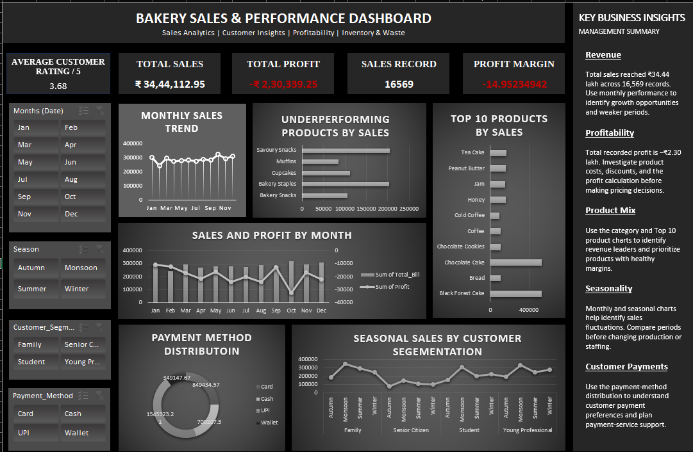

🥐 Bakery Sales & Performance Dashboard | Microsoft Excel

📌 Project Overview

This project presents an interactive Bakery Sales & Performance Dashboard built in Microsoft Excel. It transforms bakery transaction data into a visual summary of sales performance, product mix, customer ratings, payment preferences, profitability, and seasonal patterns. The dashboard uses KPI cards, charts, and slicers to help explore performance across the available reporting period.

🎯 Project Objectives

• Monitor overall sales and profitability.
• Analyze monthly sales trends and seasonality.
• Compare category and product sales.
• Understand the distribution of payment methods.
• Explore sales by customer segment and season.
• Highlight data-quality checks that matter when interpreting business KPIs.

📊 Dataset Information

The project uses a synthetic bakery dataset with 16,569 records and 41 columns, covering 1 January 2023 to 31 December 2024.

Key fields include:

• Transaction ID and date
• Product, category, quantity, unit price, discount, selling price, and total bill
• Store ID, payment method, day of week, weekend, and season
• Customer ID, customer segment, loyalty membership, and customer rating
• Profit and promotion fields
• Inventory and waste fields, including units produced, units sold, unsold units, expiry risk, and waste cost

The dashboard is designed around sales and performance reporting. Inventory and waste measures should be interpreted only after checking whether values repeat across transaction-level rows.

📈 Dashboard Features

• KPI cards: Total Sales, Total Profit, Sales Records, Average Customer Rating, and Profit Margin.
• Monthly Sales Trend: Tracks changes in sales across the reporting period.
• Sales by Category: Compares revenue across product categories.
• Top 10 Products by Sales: Highlights products with the highest recorded sales value.
• Sales and Profit by Month: Compares monthly sales and profit.
• Payment Method Distribution: Shows the sales distribution across Card, Cash, UPI, and Wallet.
• Seasonal Sales by Customer Segment: Compares seasonal sales across customer groups.
• Interactive slicers: Filter the dashboard by month, season, customer segment, and payment method.
• Key Business Insights panel: Summarizes findings, caveats, and recommendations alongside the charts.

🧮 Key Metrics

|Metric                                            |Value shown in the dashboard|
|--------------------------------------------------|---------------------------:|
|Total Sales                                       |₹3,444,112.95               |
|Total Profit                                      |-₹230,339.25                |
|Sales Records                                     |16,569                      |
|Unique Customers in the source data               |2,173                       |
|Average Customer Rating                           |3.68 / 5                    |
|Profit Margin (recalculated from displayed totals)|Approximately -6.69%        |

Metric note: The dashboard screenshot currently displays a Profit Margin of approximately -14.95. Using the displayed total profit divided by total sales gives approximately -6.69%. Check the formula and number format in Excel before publishing the final dashboard.

🔎 Preliminary Insights

• Total recorded sales are approximately ₹34.44 lakh across the 16,569 dataset records.
• Recorded profit is negative at approximately -₹2.30 lakh, so the cost and profit calculation should be reviewed before making business decisions.
• Cakes have the highest category sales in the source data.
• UPI has the highest recorded sales value among the listed payment methods.
• The average customer rating is approximately 3.68 out of 5.

These are descriptive findings from the dataset, not proof of the causes behind profit performance. Use the dashboard filters to explore differences by month, category, customer segment, season, and payment method.

🧹 Data Quality Considerations

• Verify the Profit Margin KPI. Based on the displayed totals, Total Profit / Total Sales is approximately -6.69%.
• Review blank values in fields such as Promotion_Type and Festival. Determine whether blanks mean “no promotion/festival” or missing information before relabeling them.
• Check category labels and any blank categories in PivotTables or charts.
• Transaction_ID has 16,569 unique values in the provided source file; the dashboard label “Sales Record” is therefore more precise than “Sales” or “Orders” unless order-level meaning is confirmed.
• Validate the grain of inventory fields before summing Stock_Available, Units_Produced, Units_Sold, Unsold_Units, or Waste_Cost. Repeated values can inflate totals.

🛠 Tools & Techniques

• Microsoft Excel — dashboard layout and interactive reporting
• Excel Tables — structured source data
• PivotTables and PivotCharts — summarization and visual analysis
• Slicers — interactive filtering
• Excel formulas — KPI calculations and derived metrics
• Data cleaning and validation — checking missing values, categories, and calculation consistency

💡 Skills Demonstrated

• Data cleaning and validation
• Exploratory data analysis
• KPI development
• PivotTable and PivotChart creation
• Sales and profitability analysis
• Customer and product analysis
• Dashboard layout and data storytelling
• Business insights and recommendations

📷 Dashboard Preview

✅ Conclusion

This Excel dashboard brings the main bakery sales and performance indicators into one interactive view. It supports exploration of monthly trends, category and product performance, payment preferences, and customer segments. The primary follow-up is to validate the profit-margin formula and confirm the aggregation rules for inventory and waste measures before using them for operational decisions.
